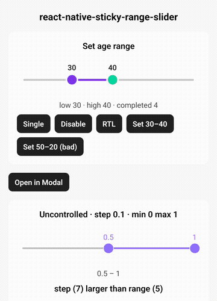
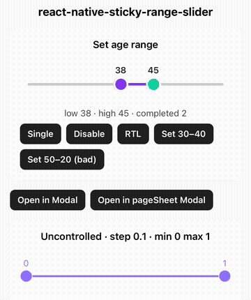

# react-native-sticky-range-slider

A fast, accessible range slider for React Native whose value labels **stick to the thumbs**.

- Gestures and thumb animation run on the UI thread (Reanimated worklets + Gesture Handler)
- Range or single thumb, `step` snapping (decimals without float noise), `minRange`, tap-to-seek
- Thumbs never cross; overlapping thumbs follow the drag direction
- Accessible: each thumb is an `adjustable` element with increment/decrement actions; 44 pt touch height
- RTL aware, works inside `<Modal>` on Android without extra setup
- New Architecture (Fabric), React 19, Reanimated 4 (and 3), Gesture Handler 3 (and 2), Expo
- TypeScript, ESM + CommonJS, zero dependencies

| Android | iOS |
| :-: | :-: |
|  |  |

## Installation

```sh
npm install react-native-sticky-range-slider
# peer dependencies
npx expo install react-native-reanimated react-native-gesture-handler   # Expo
npm install react-native-reanimated react-native-gesture-handler        # bare React Native
```

Follow the Reanimated and Gesture Handler installation guides. Wrapping your app in
`GestureHandlerRootView` is recommended (the slider also renders one internally, which is what
makes it work inside a React Native `<Modal>` on Android).

| Peer | Supported |
| --- | --- |
| `react-native` | ≥ 0.76 |
| `react-native-reanimated` | ≥ 3.16 (incl. 4.x with `react-native-worklets`) |
| `react-native-gesture-handler` | ≥ 2.20 (incl. 3.x) |

Verified on Android 14 and iOS 26 with Expo SDK 58 (React Native 0.88, New Architecture,
Reanimated 4.7, Gesture Handler 3.3); type-checked against Reanimated 3.16 / Gesture Handler 2.20 /
React 18.

## Usage

```tsx
import { useState } from 'react';
import { Text, View } from 'react-native';
import RangeSlider from 'react-native-sticky-range-slider';

export function AgeFilter() {
  const [range, setRange] = useState({ low: 18, high: 60 });

  return (
    <View style={{ padding: 24 }}>
      <RangeSlider
        min={18}
        max={60}
        step={1}
        minRange={5}
        low={range.low}
        high={range.high}
        onValueChanged={(low, high) => setRange({ low, high })}
        onSlidingComplete={(low, high) => console.log('save', low, high)}
        renderLowValue={(value) => <Text>{value}</Text>}
        renderHighValue={(value) => <Text>{value === 60 ? '60+' : value}</Text>}
      />
    </View>
  );
}
```

Leave out `low`/`high` for an uncontrolled slider (it starts at `min`/`max`). Use
`disableRange` for a single thumb.

### Custom look

```tsx
<RangeSlider
  min={0}
  max={100}
  step={5}
  renderThumb={(type) => <View style={[styles.thumb, type === 'high' && styles.highThumb]} />}
  renderRail={() => <View style={{ flex: 1, height: 4, borderRadius: 2, backgroundColor: '#ddd' }} />}
  renderRailSelected={() => <View style={{ height: 4, borderRadius: 2, backgroundColor: '#8338ec' }} />}
/>
```

## Props

| Prop | Type | Default | Description |
| --- | --- | --- | --- |
| `min` / `max` | `number` | **required** | Range. `max < min` is treated as `max = min`. |
| `step` | `number` | **required** | Distance between values. `0` = continuous. `max` is always reachable. |
| `minRange` | `number` | `0` | Minimum distance between the thumbs (clamped to the range). |
| `low` / `high` | `number` | `min` / `max` | Values. When provided, the slider follows them; invalid values are clamped and ordered. |
| `onValueChanged` | `(low, high) => void` | – | Every user change (drag, tap, accessibility action) – once per step, not per frame. Not called for prop changes. |
| `onSlidingStart` | `(thumb: 'low' \| 'high') => void` | – | A drag starts. |
| `onSlidingComplete` | `(low, high) => void` | – | The finger is released (also after a tap or accessibility action). |
| `renderThumb` | `(type) => ReactNode` | purple dot | Thumb (both thumbs should have the same width). |
| `renderRail` | `() => ReactNode` | grey line | Full rail (should stretch: `flex: 1`). |
| `renderRailSelected` | `() => ReactNode` | purple line | Selected part of the rail. |
| `renderLowValue` / `renderHighValue` | `(value) => ReactNode` | number | Label above each thumb. Return `null` to hide. |
| `disableRange` | `boolean` | `false` | Single thumb (`low`). |
| `disabled` | `boolean` | `false` | Ignore user interaction. |
| `inverted` | `boolean` | `I18nManager.isRTL` | `min` on the right. |
| `hitSlop` | `number \| Insets` | `{ top: 8, bottom: 8, left: 12, right: 12 }` | Extra touch area. The slider itself is at least 44 pt tall. |
| `thumbAccessibilityLabel` | `(type) => string` | `'Minimum'` / `'Maximum'` / `'Value'` | Screen reader label of a thumb. |
| `formatAccessibilityValue` | `(value) => string` | `String` | Screen reader value text. |
| `...ViewProps` | | | `style`, `testID`, … for the container. |
| `pannableAreaStyle` | | | **Deprecated**, ignored (see migration). |

## Migrating from 0.x

1.0 is a rewrite on Gesture Handler + Reanimated (0.x used `PanResponder` and `Animated` on the
JS thread).

1. Install the new peer dependencies `react-native-reanimated` and `react-native-gesture-handler`.
2. Props are unchanged except:
   - `onValueChanged` is no longer called on mount, on layout or when you change `low`/`high`
     yourself – only for user changes. Use `onSlidingComplete` for “change end” work.
   - `pannableAreaStyle` is ignored: the whole slider (at least 44 pt tall) is touchable; use
     `hitSlop` to enlarge it.
   - The slider is now at least 44 pt tall (it used to be as tall as the thumb), and the value
     labels are centered above the thumbs.
3. Fixed: dragging inside a React Native `<Modal>` on Android / Expo SDK 53+ (issue #1),
   overlapping thumbs picked the thumb by touch side instead of drag direction (so they could get stuck), float noise with decimal steps, the pannable area
   did not extend beyond the slider, missing `main` entry in `package.json`.

## Example app

```sh
yarn
yarn example start   # press a / i, or open it in Expo Go (SDK 58)
```

It includes the README demo inside a React Native `<Modal>` (issue #1), RTL, disabled state and edge
cases (decimal steps, `step > max - min`, `min === max`). Screenshots from emulator runs are in
[`docs/screenshots`](./docs/screenshots).

## License

MIT

Originally forked from [rn-range-slider](https://www.npmjs.com/package/rn-range-slider).
