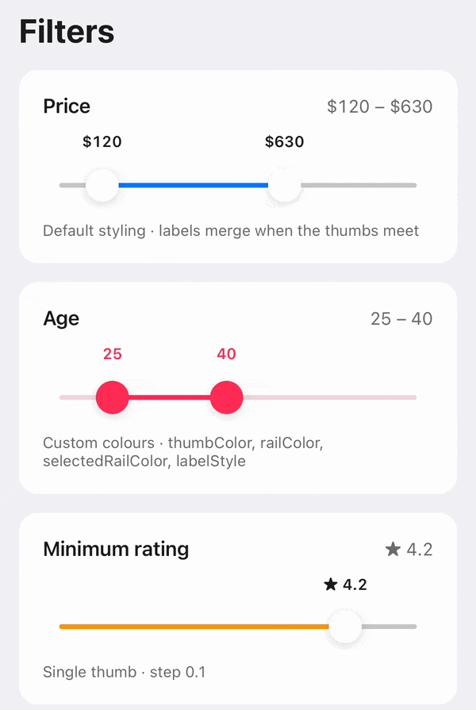

# react-native-sticky-range-slider

[](https://www.npmjs.com/package/react-native-sticky-range-slider)
[](./LICENSE)
[](https://github.com/hancandice/react-native-sticky-range-slider/actions)

A two-thumb range slider whose value labels ride on the thumbs. 60 fps on the UI thread, accessible, RTL-ready.

<p align="center">
  
</p>

```tsx
<RangeSlider min={0} max={500} step={10} low={low} high={high}
  onValueChange={(l, h) => { setLow(l); setHigh(h); }} />
```

- Labels follow the thumbs and merge when they meet
- Range or single thumb, `step` (decimals without float noise) or continuous, `minRange`, tap to seek
- VoiceOver / TalkBack adjustable thumbs, 44 pt touch target, RTL, dark mode
- Works inside `<Modal>` on Android, New Architecture, Expo, Reanimated 3 & 4

## Install

```sh
npx expo install react-native-sticky-range-slider react-native-reanimated react-native-gesture-handler
```

Bare React Native:

```sh
npm install react-native-sticky-range-slider react-native-reanimated react-native-gesture-handler
```

Then follow the [Reanimated](https://docs.swmansion.com/react-native-reanimated/docs/fundamentals/getting-started/)
(Reanimated 4 also needs `react-native-worklets`) and
[Gesture Handler](https://docs.swmansion.com/react-native-gesture-handler/docs/fundamentals/installation)
setup. Wrapping your app in `GestureHandlerRootView` is recommended; the slider also renders one
internally, which is what makes it work inside a React Native `<Modal>` on Android (on Android this
logs a harmless "already enabled" note when an outer root view exists).

| Peer | Range | Verified |
| --- | --- | --- |
| `react-native` | ≥ 0.76 | 0.88 (New Architecture) on Android 14 and iOS 26, Expo SDK 58 |
| `react-native-reanimated` | ≥ 3.16 < 5 | 4.7 on device; 3.16 type-checked (`yarn typecheck:min`) |
| `react-native-gesture-handler` | ≥ 2.20 < 4 | 3.3 on device; 2.20 type-checked |
| `react` | ≥ 18.2 | 19.3 on device; 18 type-checked |

## Props

| Prop | Type | Default | Description |
| --- | --- | --- | --- |
| `min` / `max` | `number` | **required** | Range. `max < min` is treated as `max = min`. |
| `step` | `number` | `1` | Distance between values; `0` = continuous. `max` is always reachable, even when `max - min` is not a multiple of `step`. |
| `minRange` | `number` | `0` | Minimum distance between the thumbs. The limits stay on the step grid. |
| `low` / `high` | `number` | `min` / `max` | Values. When provided the slider follows them; they are clamped, ordered and snapped to the step grid. Leave them out for an uncontrolled slider. |
| `onValueChange` | `(low, high) => void` | – | Every user change (drag, tap, accessibility action) — once per step, or on every frame of a drag when `step` is `0`. Not called when you change `low`/`high`. |
| `onSlidingStart` | `(thumb: 'low' \| 'high') => void` | – | A drag starts. |
| `onSlidingComplete` | `(low, high) => void` | – | The finger is released (also after a tap or accessibility action). |
| `disableRange` | `boolean` | `false` | Single thumb (`low`). |
| `disabled` | `boolean` | `false` | Ignore user interaction and render at 38 % opacity. |
| `inverted` | `boolean` | `I18nManager.isRTL` | `min` on the right. |
| `labelPosition` | `'top' \| 'none'` | `'top'` | `top` reserves room above the rail for the labels, so they never overlap the content above. |
| `formatLabel` | `(value) => string` | `String` (2 decimals when `step` is 0) | Text of the default labels. Labels re-render only when this text changes. |
| `thumbColor` | `string` | `#FFFFFF` | Default thumb fill (28 pt, hairline border, soft shadow). |
| `railColor` | `string` | `#C7C7CC` (dark: `#48484A`) | Default rail. |
| `selectedRailColor` | `string` | `#007AFF` (dark: `#0A84FF`) | Default selected rail. |
| `labelStyle` | `TextStyle` | 13 pt, semibold, tabular numbers | Style of the default labels. |
| `renderThumb` | `(type, { pressed, disabled }) => ReactNode` | white dot | Custom thumb (both thumbs should have the same size). |
| `renderRail` / `renderRailSelected` | `() => ReactNode` | 4 pt lines | Custom rails (the full rail should stretch: `flex: 1`). |
| `renderLowValue` / `renderHighValue` | `(value) => ReactNode` | label | Custom labels. Return `null` to hide one. |
| `hitSlop` | `number \| Insets` | `{ top: 8, bottom: 8, left: 12, right: 12 }` | Extra touch area around the slider (which is at least 44 pt tall). |
| `accessibilityLabel` | `string` | – | Prefix of the thumb labels, e.g. `"Price, Minimum"`. |
| `thumbAccessibilityLabel` | `(type) => string` | `'Minimum'` / `'Maximum'` / `'Value'` | Full screen-reader label of a thumb (overrides the prefix). |
| `formatAccessibilityValue` | `(value) => string` | `formatLabel` | Screen-reader value text. |
| `...ViewProps` | | | `style`, `testID`, … for the container. |
| `onValueChanged` | | | **Deprecated** alias of `onValueChange`. |
| `pannableAreaStyle` | | | **Deprecated**, ignored — use `hitSlop`. |

Drags follow the finger 1:1; taps and accessibility actions animate the thumb (150 ms), the pressed
thumb grows to 1.15×, and all motion honours the system **Reduce Motion** setting.

## Recipes

**Price filter with currency labels**

```tsx
<RangeSlider
  min={0} max={1000} step={10} minRange={50}
  low={price.low} high={price.high}
  formatLabel={(v) => '$' + v}
  onValueChange={(low, high) => setPrice({ low, high })}
  onSlidingComplete={(low, high) => refetch(low, high)}
  accessibilityLabel="Price"
/>
```

**Custom colours / dark mode**

```tsx
<RangeSlider min={18} max={65} thumbColor="#FF2D55" selectedRailColor="#FF2D55"
  railColor={dark ? '#3A3A3C' : '#F2D7DE'} labelStyle={{ color: '#FF2D55' }} />
```

**Single continuous slider**: `<RangeSlider min={0} max={1} step={0} disableRange onValueChange={(v) => setVolume(v)} />`

## Migrating from 0.x

1.0 is a rewrite on Gesture Handler and Reanimated (0.x used `PanResponder` and `Animated` on the JS thread).

1. Install the new peer dependencies `react-native-reanimated` and `react-native-gesture-handler`.
2. `onValueChanged` → `onValueChange` (the old name still works with a one-time warning in development).
   It is no longer called on mount, on layout or when you change `low`/`high` yourself — only for user
   changes. Use `onSlidingComplete` for “change end” work.
3. New look: 28 pt white thumbs, 4 pt rails, labels above the thumbs in reserved space (the slider is
   taller than before), at least 44 pt touch height. Your `render*` props keep working; `renderThumb`
   now also receives `{ pressed, disabled }`.
4. `step` is optional (default `1`); `0` makes the slider continuous. Initial values are snapped to the grid.
5. `pannableAreaStyle` is ignored: the whole slider is touchable; use `hitSlop` to enlarge it.
6. Fixed: dragging inside a React Native `<Modal>` on Android / Expo SDK 53+
   ([#1](https://github.com/hancandice/react-native-sticky-range-slider/issues/1)), overlapping thumbs,
   float noise with decimal steps, and the missing `main` entry in `package.json`.

## Example app

```sh
yarn
yarn example start   # press a / i, or open it in Expo Go (SDK 58)
```

*Showcase* is a filters card (default and custom-coloured sliders, light and dark mode);
*Edge cases* has the 0.x README demo inside a React Native `<Modal>` (issue #1), RTL, disabled state,
continuous and decimal steps, merging labels and degenerate ranges. Screenshots from emulator runs
are in [`docs/screenshots`](./docs/screenshots).

## License

MIT · Originally forked from [rn-range-slider](https://www.npmjs.com/package/rn-range-slider).
